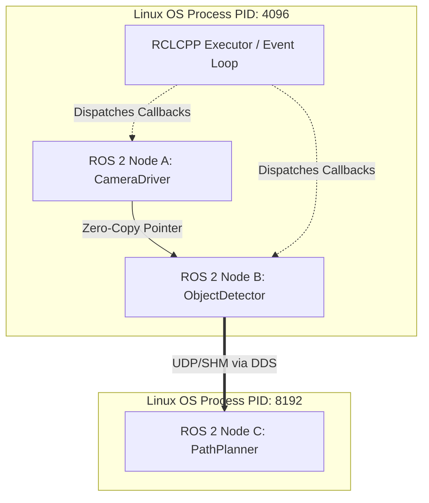

# 第 1 章：从 Linux 视角构建 ROS 2 心智模型

对于熟悉 Linux 系统编程、网络与运维的工程师而言，ROS 2（Robot Operating System 2）并不是一个传统意义上的操作系统内核，而是一套**基于分布式发布-订阅中间件（DDS）的机器人应用开发框架与进程编排运行时**。

本章跳过泛泛的概念灌输，直接使用 Linux 工程师熟悉的底层抽象（进程、线程、IPC、Socket、文件描述符、POSIX 信号与网络协议）对齐 ROS 2 的核心概念。

---

## 1.1 Linux vs ROS 2 核心抽象对照表

| Linux 操作系统概念 | ROS 2 对应概念 | 底层机制与本质对照 |
| :--- | :--- | :--- |
| **可执行文件 (ELF)** | ROS 2 节点可执行程序 | 编译出的普通 Linux ELF 二进制程序或 Python 解释器脚本。 |
| **进程 (Process)** | Node 或 Component 容器 | 单个进程内可以包含 1 个或多个 ROS 2 Node（单进程多节点架构）。 |
| **POSIX 线程 / epoll** | Executor / CallbackGroup | 事件驱动循环（Event Loop），基于 epoll/select 监听 DDS 句柄并调度回调。 |
| **Unix Domain Socket / Pipe / TCP** | Topic (发布/订阅) | 基于 DDS 的去中心化、多对多数据流传输，支持内存局部性优化。 |
| **RPC / HTTP REST API** | Service (请求/响应) | 基于 DDS 实现的双向客户端/服务端调用，具备超时与异步 Future 语义。 |
| **长期后台任务 (worker thread + cancel)** | Action (动作通信) | 组合了 3 个 Service（目标、取消、结果）与 2 个 Topic（反馈、状态）的状态机。 |
| **共享内存 (`shm_open`, `mmap`)** | iceoryx/loaned_message | 零拷贝进程间通信（Zero-Copy IPC），避免海量点云/图像的大块内存拷贝。 |
| **IP 组播 (UDP Multicast 239.255.0.1)** | discovery/rtps 节点发现 | 基于 RTPS 协议在 LAN 内组播广播节点 GUID、端点信息与 QoS，无需集中 Master。 |
| **环境变量 / 动态链接路径 (`LD_LIBRARY_PATH`)** | Workspace Overlay (`AMENT_PREFIX_PATH`) | 分层目录搜索机制，下游 Workspace 优先覆盖上游环境。 |
| **POSIX 信号机制 (`Signal / SIGINT / SIGTERM`)** | lifecycle/shutdown | 捕获系统退出信号，优雅销毁 DDS 句柄、释放资源并通知集群下线。 |
| **服务守护与调度 (`cron/systemd`)** | ROS 2 Launch 系统 | 基于 Python/XML 的多进程生命周期监管、参数注入、环境变量配置与重命名。 |
| **系统调用与追踪 (`strace`)** | ros2 cli/tracing 诊断 | 结合 Linux 原生抓包追踪工具与 ROS 2 语义化诊断命令行。 |
| **内核参数与网络调优 (`sysctl`)** | qos/dds profiles 配置 | 通过微调网络传输属性与 DDS 配置文件控制通信行为与资源队列。 |

---

## 1.2 架构演进：从 ROS 1 到 ROS 2 的本质变化

ROS 1 采用中心化的 `roscore`（XML-RPC Master），所有节点的拓扑发现必须向 Master 注册，通信基于自研的 TCPROS/UDPROS。在工业生产中，`roscore` 存在单点故障（SPOF）、无安全鉴权、实时性不可靠等致命缺陷。

ROS 2 完全废除了集中式 Master，采用了工业级工业自动化标准——**DDS（Data Distribution Service）**与 **RTPS（Real-Time Publish-Subscribe）**协议：

```
+-------------------------------------------------------------+
|                  User Application Code                      |
|           (C++: rclcpp  /  Python: rclpy)                   |
+-------------------------------------------------------------+
|              RCL (ROS Client Library - Pure C)              |
+-------------------------------------------------------------+
|              RMW (ROS Middleware Interface - C)             |
+-------------------------------------------------------------+
|     DDS Implementation (CycloneDDS / FastDDS / Connext)     |
+-------------------------------------------------------------+
|              Transport Layer (UDP / TCP / SHM)              |
+-------------------------------------------------------------+
|                  Linux Kernel (POSIX API)                   |
+-------------------------------------------------------------+
```

### 关键设计优势：
1. **去中心化（Decentralized）**：只要处于同一个物理子网（或路由可达）且配置了相同的 `ROS_DOMAIN_ID`，两个节点通过 UDP 组播即可自动完成握手建立通道。
2. **语言中立性（Language Agnostic via RCL）**：C++（`rclcpp`）与 Python（`rclpy`）并非各自实现一遍协议，而是统一构建在纯 C 编写的 `rcl`（ROS Client Library）及 `rmw`（ROS Middleware Interface）之上，保证了跨语言行为的一致性与内存安全性。
3. **确定性 QoS（Quality of Service）**：不同于 TCP 的单一全可靠交付，ROS 2 允许为传感器数据流（如 60FPS 激光雷达点云）配置 Best Effort 丢失容忍策略，为控制指令配置 Reliable 交付策略。

---

## 1.3 进程模型与执行器（Executor & CallbackGroup）

在 Linux 系统编程中，高并发网络服务通常采用 `epoll` + 线程池（如 Reactor / Proactor 模式）。ROS 2 的执行模型与此高度一致。

### 节点（Node）与进程（Process）的拓扑关系
在 ROS 2 中：
- 一个可执行程序在 Linux 中是一个普通的 OS 进程。
- 一个进程可以实例化多个 `rclcpp::Node` 实例。
- **Component（组件式编程）**：允许多个 Node 作为动态共享库（`.so`）在运行时通过 `dlopen()` 动态加载到同一个进程容器（`ComposableNodeContainer`）中。此时节点间的 Topic 通信自动退化为指针传递（`std::shared_ptr` / `std::unique_ptr`），完全绕过网络协议栈与内存拷贝，达到纳秒级延迟。



### 执行器（Executor）与回调组（CallbackGroup）

默认情况下，ROS 2 是**单线程事件循环**（`SingleThreadedExecutor`）。这意味着如果某个定时器回调或者服务回调执行了长时间的阻塞操作（例如 `sleep()`、阻塞 I/O 或耗时计算），它会饥饿掉该节点的所有其他回调（包括心跳与话题接收）。

为了避免该问题，Linux 工程师应当熟练使用多线程执行器与回调组：

```cpp
#include "rclcpp/rclcpp.hpp"

class AdvancedNode : public rclcpp::Node {
public:
  AdvancedNode() : Node("advanced_node") {
    // 1. 创建互斥回调组（组内串行，与其他组并行）
    timer_cb_group_ = this->create_callback_group(
      rclcpp::CallbackGroupType::MutuallyExclusive);
      
    // 2. 创建可重入回调组（组内多个回调可由线程池并发调度）
    service_cb_group_ = this->create_callback_group(
      rclcpp::CallbackGroupType::Reentrant);

    rclcpp::SubscriptionOptions sub_options;
    sub_options.callback_group = timer_cb_group_;
    
    // 绑定至指定回调组
    sub_ = this->create_subscription<std_msgs::msg::String>(
      "input_stream", 10,
      std::bind(&AdvancedNode::on_message, this, std::placeholders::_1),
      sub_options);
  }

private:
  void on_message(const std_msgs::msg::String::SharedPtr msg) {
    // 处理逻辑...
  }
  rclcpp::CallbackGroup::SharedPtr timer_cb_group_;
  rclcpp::CallbackGroup::SharedPtr service_cb_group_;
  rclcpp::Subscription<std_msgs::msg::String>::SharedPtr sub_;
};
```

在 `main()` 函数中挂载到 `rclcpp::executors::MultiThreadedExecutor`，底层自动构建 POSIX 线程池来分发处理事件。

---

## 1.4 文件描述符与网络通道：DDS 底层映射

如果你在 Linux 终端执行：
```bash
lsof -p <ros2_node_pid>
```
你会观察到以下典型输出：
1. **epoll 句柄**：用于监听事件队列与定时器 `timerfd`。
2. **UDP Sockets (组播与单播)**：
   - 绑定在端口 `7400`（默认 Domain ID 0 的组播自发现端口）。
   - 绑定在端口 `7410`、`7411` 等（节点单播接收数据端口与单播发现端口）。
3. **共享内存文件描述符**：`/dev/shm` 下的映射文件（若开启了 CycloneDDS / FastDDS 共享内存传输或 Iceoryx）。

这表明，ROS 2 没有任何黑魔法，它遵循标准的 Linux POSIX IPC 与 Berkeley Sockets 规约。

---

## 1.5 总结与快速迁移路径

- **调试习惯迁移**：当你怀疑 ROS 2 两个节点连不上时，不要盲目重启，像调试 Linux 网络服务一样：先查路由和 IP（`ip a`）、查组播是否通畅（`ros2 multicast receive` / `iperf`）、查端口占用（`ss -ulpn`）、查防火墙策略（`iptables` / `ufw`）。
- **代码思维迁移**：把 Node 视为轻量级的逻辑组件，把 Executor 视为调度器；避免在回调中阻塞，需要共享内存时善用 Composition 容器。
- 接下来，我们将进入第二章，深入解构 ROS 2 的工作空间、构建系统与环境变量的底层机制。
