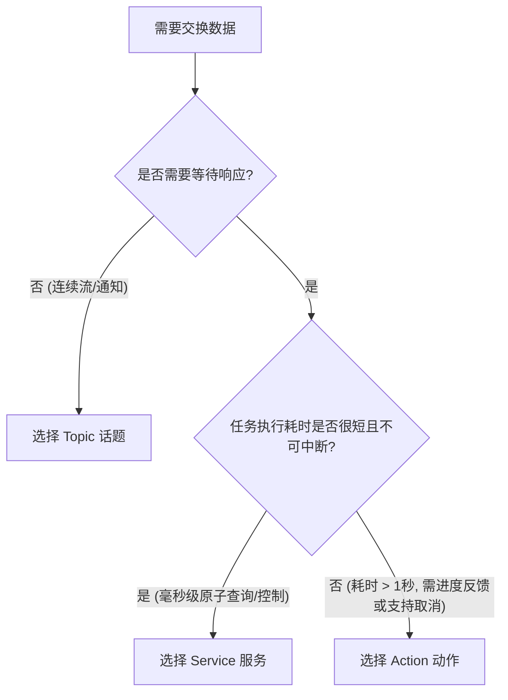
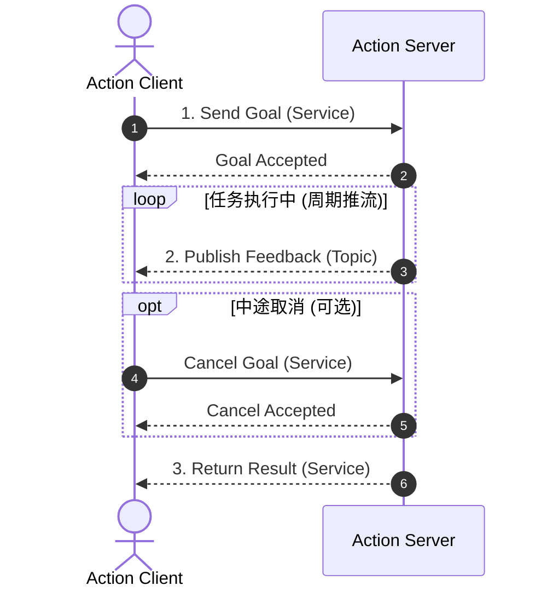

# 第 3 章：三大核心通信范式深度剖析：Topic、Service 与 Action

在分布式机器人系统中，不同的数据交互场景对实时性、可靠性与交互拓扑有着截然不同的诉求。
ROS 2 提供了三种核心通信机制：
1. **Topic（话题）**：单向、松耦合、多对多的流式数据管道。
2. **Service（服务）**：双向、同步/异步、一对一的 RPC 远程调用。
3. **Action（动作）**：带反馈、可取消、面向长时间执行任务的状态机交互。

本章从 Linux 系统编程视角深入解构它们的设计意图、底层交互机制与避坑指南。

---

## 3.1 范式选型决策矩阵

| 通信机制 | Linux / 网络对应物 | 典型交互模式 | 实时性/控制 | 典型应用场景 |
| :--- | :--- | :--- | :--- | :--- |
| **Topic** | UDP 组播 / Unix Domain Socket 流 | 单向连续推流 (1:N, N:M) | 极高，支持丢包容忍或可靠重传 | 激光雷达点云、IMU、轮速计、图像数据流 |
| **Service** | HTTP REST / gRPC 一问一答 | 双向原子调用 (1:1 Client-Server) | 中等，阻塞等待结果，不适宜耗时任务 | 相机标定触发、参数查询、模式切换、机械臂使能 |
| **Action** | 带取消与进度的后台 Worker 任务 | 双向状态机 (Goal/Cancel/Feedback/Result) | 面向过程监控，异步非阻塞 | 导航到指定经纬度、机械臂轨迹规划执行、建图任务 |



---

## 3.2 话题机制（Topic）与 QoS 配置策略

Topic 是基于 DDS 的发布-订阅抽象。数据通过 CDR（Common Data Representation）序列化后通过底层网络（UDP）或共享内存（SHM）发送。

### QoS（服务质量）是 ROS 2 的灵魂
Linux 开发者熟悉 TCP（绝对可靠但存在队头阻塞和高延迟）与 UDP（无连接极速但可能丢包）。
ROS 2 的 **QoS** 允许你在应用层针对每个 Topic 细粒度调控传输语义：

1. **Reliability（可靠性策略）**：
   - `RELIABLE`：保证数据包不丢失。底层 DDS 使用 NACK/ACK 重传机制（类似 TCP）。
   - `BEST_EFFORT`：尽最大努力交付。底层直接发 UDP，不重传（极低延迟，适合 100Hz IMU、60Hz 视频帧）。
2. **Durability（持久性策略）**：
   - `VOLATILE`：易失性，新订阅者上线不会收到之前的任何历史数据。
   - `TRANSIENT_LOCAL`：瞬态本地持久化。发布者在本地保留最新 N 帧，**晚加入的订阅者上线后立即补发**（极其适合机器人地图 `/map`、静态配置）。
3. **History 与 Depth（历史队列深度）**：
   - `KEEP_LAST` + `depth`：仅保留最近 `depth` 条数据，溢出覆盖最旧数据（防止接收端处理过慢导致内存无限膨胀）。
   - `KEEP_ALL`：保留全部数据（受底层物理内存限制）。

### QoS 不兼容性陷阱（Incompatible QoS）
> **黄金法则**：订阅者的 QoS 要求不能苛刻于发布者的供给能力。
> - 如果发布者是 `BEST_EFFORT`，而订阅者配置了 `RELIABLE`，**DDS 发现阶段将拒绝握手，订阅者将永远收不到消息**！
> - 调试命令：`ros2 topic info /my_topic --verbose`，可清晰排查 Publisher 与 Subscriber 的 QoS 协商失败原因。

---

## 3.3 服务机制（Service）与死锁陷阱

Service 提供了经典的 Client-Server RPC 抽象：
- 请求端发送 `Request`，返回一个 `std::shared_future<Response>`。
- 服务端在回调中处理业务并填充 `Response`。

### 致命反模式：单线程执行器中的自死锁（Deadlock）
这是几乎每个初学者都会踩入的巨坑：

```cpp
// 错误示例：在定时器或订阅回调中同步等待服务响应
void on_timer() {
  auto request = std::make_shared<MySrv::Request>();
  // 错误！在单线程环境下，当前线程被当前定时器回调霸占
  // 底层服务响应的回调根本没有线程可以分发，程序陷入永久死锁！
  auto result_future = client_->async_send_request(request);
  if (rclcpp::spin_until_future_complete(node_, result_future) == 
      rclcpp::FutureReturnCode::SUCCESS) {
    // 永远进不来
  }
}
```

### 正确解法：
1. **异步 Promise 链式处理**：
   ```cpp
   client_->async_send_request(request, 
     [](rclcpp::Client<MySrv>::SharedFuture future) {
       auto response = future.get();
       // 处理响应...
     });
   ```
2. **使用多线程执行器 + 独立回调组**：
   将 Client 挂载到 `MutuallyExclusiveCallbackGroup`，并使用 `MultiThreadedExecutor`，确保事件循环有独立的空闲工作线程可以调度响应处理。

---

## 3.4 动作机制（Action）状态机与内部通道

如果机器人底盘执行一次 “导航至目标点（MoveBase）” 需要耗时 30 秒，使用 Service 会带来极大风险：调用方必须长时间阻塞等待，且无法获知机器人当前走到了哪一步，更无法中途下发“紧急刹车（Cancel）”指令。

Action 是专为复杂长周期行为设计的状态机模型。

### Action 底层解构
一个 Action 命名为 `/navigate_to_pose`，在底层 DDS 层面实际拆解为 **3 个 Service 和 2 个 Topic**：
1. `~/send_goal` (Service)：发送目标并协商是否接受（`ACCEPTED` 或 `REJECTED`）。
2. `~/cancel_goal` (Service)：请求中止正在执行的目标。
3. `~/get_result` (Service)：任务完成时拉取最终执行结果。
4. `~/feedback` (Topic)：服务器以固定频率（如 10Hz）推送当前执行状态与中间进度（如距离目标剩余 2.4 米）。
5. `~/status` (Topic)：广播所有正在跟踪的 Goal 状态机跃迁。



---

## 3.5 总结

- **Topic**：无状态数据流的首选，务必严格关注 QoS 匹配。
- **Service**：轻量级原子指令的首选，严禁在主事件循环中同步阻塞等待。
- **Action**：复杂运动控制与耗时任务的工业标准，内置完备的取消机制与反馈流。

下一章我们将深入探讨如何对这些节点进行集中化参数配置（Parameter）以及如何使用 Launch 系统完成工业级多进程拉起与编排。
