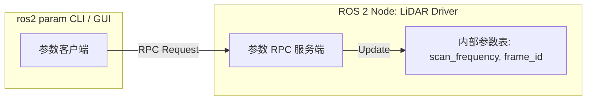
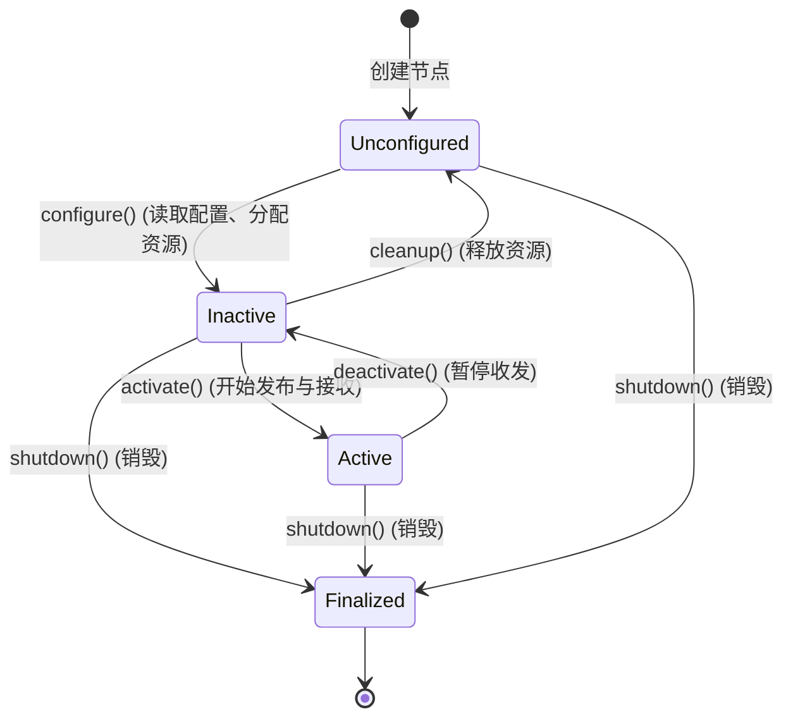

# 第 4 章：参数系统与多进程编排（Launch 系统）

在 Linux 服务端或嵌入式系统中，我们通常使用命令行选项（`getopt_long`）、环境变量或配置文件（如 JSON/YAML/TOML）来管理系统参数，并借助 `systemd`、`supervisord` 或 `docker-compose` 来管理多进程的启停与依赖。

ROS 2 提供了两套标准基础设施：
1. **去中心化参数系统（Parameter System）**：每个节点自主持有、支持动态更新与强类型校验的配置机制。
2. **Launch 编排系统（Launch System）**：基于 Python/XML 的多进程生命周期监管、参数注入、拓扑重映射与事件联动引擎。

---

## 4.1 去中心化参数系统（Parameter System）

### ROS 1 与 ROS 2 参数架构的根本区别
- **ROS 1**：所有参数都集中存放在 `roscore` 的全局字典中，节点启动时远程拉取。一旦 Master 崩溃，参数全部丢失；且无法有效感知参数在运行时的动态修改。
- **ROS 2**：**参数是去中心化的（Decentralized）**。参数的所有权归各个 Node 内部持有。节点通过内置的隐藏服务（如 `~/get_parameters`、`~/set_parameters`）向外界暴露读写接口。



### C++ 参数声明与动态回调监听

在 ROS 2 中，使用参数前**必须显式声明（Declare）**，以确保类型安全与默认值约束：

```cpp
#include "rclcpp/rclcpp.hpp"
#include "rcl_interfaces/msg/set_parameters_result.hpp"

class MotorController : public rclcpp::Node {
public:
  MotorController() : Node("motor_controller") {
    // 1. 声明参数并赋默认值
    this->declare_parameter<double>("max_speed", 2.0);
    this->declare_parameter<std::string>("log_level", "INFO");

    // 2. 读取参数
    current_max_speed_ = this->get_parameter("max_speed").as_double();

    // 3. 注册动态参数回调 (类似于 Linux 内核的 sysctl 运行时修改)
    param_cb_handle_ = this->add_on_set_parameters_callback(
      [this](const std::vector<rclcpp::Parameter> &params) {
        rcl_interfaces::msg::SetParametersResult result;
        result.successful = true;
        for (const auto &param : params) {
          if (param.get_name() == "max_speed") {
            if (param.as_double() <= 0.0 || param.as_double() > 10.0) {
              result.successful = false;
              result.reason = "max_speed must be in (0.0, 10.0]";
              return result;
            }
            this->current_max_speed_ = param.as_double();
            RCLCPP_INFO(this->get_logger(), "Updated max_speed: %.2f", current_max_speed_);
          }
        }
        return result;
      });
  }

private:
  double current_max_speed_;
  OnSetParametersCallbackHandle::SharedPtr param_cb_handle_;
};
```

### 结构化 YAML 参数文件

生产环境中，参数统一由 YAML 文件定义。结构要求与节点命名空间严格对应：

```yaml
/**: # 作用于所有命名空间
  motor_controller:
    ros__parameters:
      max_speed: 3.5
      log_level: "DEBUG"
      pid:
        kp: 1.2
        ki: 0.05
        kd: 0.1
```

在启动时注入：
```bash
ros2 run my_pkg motor_controller --ros-args --params-file config/params.yaml
```

---

## 4.2 ROS 2 Launch 系统：工业级多进程编排

当系统规模庞大，包含数十个驱动、建图、规划与状态监控节点时，手工使用 bash 脚本 `&` 后台拉取进程非常脆弱（无法优雅处理异常退出、环境变量隔离与参数覆盖）。

ROS 2 Launch 提供了图灵完备的 Python DSL 编排能力。

### 为什么选择 Python 编写 Launch？
1. **条件分支（Conditions）**：根据运行时参数（如 `use_sim_time:=true` 或激光雷达型号）动态决定拉起哪些节点。
2. **事件总线与生命周期监管（Event Handlers）**：当底盘驱动节点退出时，自动触发紧急刹车节点或优雅拉起重启。
3. **拓扑重映射（Remapping）**：在不修改任何 C++/Python 源码的前提下，将节点的内部话题名重定向到全局特定话题。

### 生产级 Python Launch 文件模版

```python
import os
from launch import LaunchDescription
from launch.actions import DeclareLaunchArgument, LogInfo, ExecuteProcess
from launch.substitutions import LaunchConfiguration
from launch_ros.actions import Node
from ament_index_python.packages import get_package_share_directory

def generate_launch_description():
    # 1. 声明外部输入参数 (CLI 可传入 my_arg:=value)
    use_sim_time_arg = DeclareLaunchArgument(
        'use_sim_time',
        default_value='false',
        description='Use simulation clock if true'
    )

    use_sim_time = LaunchConfiguration('use_sim_time')

    # 2. 定位配置文件绝对路径
    # 类似 Linux 的 PREFIX/share/<package> 路径定位
    pkg_share = get_package_share_directory('launch_demo')
    param_file = os.path.join(pkg_share, 'config', 'params.yaml')

    # 3. 声明需要启动的 Node 进程
    talker_node = Node(
        package='cpp_topic_demo',
        executable='cpp_talker',
        name='custom_talker',
        namespace='sensor_pipeline',
        parameters=[param_file, {'use_sim_time': use_sim_time}],
        # 话题重映射: 将内部的 chatter 映射到 /sensor/telemetry
        remappings=[
            ('chatter', '/sensor/telemetry')
        ],
        output='screen', # 输出打印到标准输出
        respawn=True,    # 守护进程特性: 崩溃自动重启
        respawn_delay=2.0
    )

    listener_node = Node(
        package='py_topic_demo',
        executable='py_listener',
        name='custom_listener',
        namespace='sensor_pipeline',
        parameters=[{'use_sim_time': use_sim_time}],
        remappings=[
            ('chatter', '/sensor/telemetry')
        ],
        output='screen'
    )

    return LaunchDescription([
        use_sim_time_arg,
        LogInfo(msg="Launching ROS 2 Sensor Pipeline..."),
        talker_node,
        listener_node,
    ])
```

---

## 4.3 命名空间（Namespace）与重映射（Remap）

在多机器人或多相机协同系统中，如何复用同一套驱动逻辑？
答案是**命名空间隔离**。

- 若不配置命名空间，节点发布 `/cmd_vel`。
- 配置 `namespace='robot_1'` 后，话题自动扩展为 `/robot_1/cmd_vel`。
- 如果需要访问全局绝对话题，以斜杠开头：`/global_clock`；如果以波浪号开头：`~/my_topic`，表示私有话题，扩展为 `/namespace/node_name/my_topic`。

---

## 4.4 高级组合：组件容器（Composable Node Container）

为了极致的性能，Launch 系统支持将多个独立开发的 Node 以动态库形式加载进同一个进程容器：

```python
from launch_ros.actions import ComposableNodeContainer
from launch_ros.descriptions import ComposableNode

container = ComposableNodeContainer(
    name='image_pipeline_container',
    namespace='',
    package='rclcpp_components',
    executable='component_container',
    composable_node_descriptions=[
        ComposableNode(
            package='image_driver_pkg',
            plugin='image_driver::CameraNode',
            name='camera'),
        ComposableNode(
            package='image_proc_pkg',
            plugin='image_proc::RectifyNode',
            name='rectify'),
    ],
    output='screen',
)
```

**Linux 视角解析**：
这相当于在单个宿主进程内通过 `dlopen()` 载入两个 `.so`，并在进程内执行器中注册它们。两节点间通信直接使用指针，免除任何进程间上下文切换（Context Switch）与系统调用损耗！

---

## 4.5 确定性进程监管：生命周期节点（Lifecycle Nodes）

在大型机器人或自动驾驶系统中，普通的 Node 存在一个痛点：`main()` 函数启动后立即开始执行，无法严格控制节点间的依赖初始化时序（例如：底盘运动控制器比激光雷达驱动更早启动，导致控制器在未接收到数据时疯狂报错）。

ROS 2 引入了 **Lifecycle Node（托管生命周期节点）**，它为节点赋予了一个受控的有限状态机（FSM）：



### 核心状态与 Linux 运维对照

1. **`Unconfigured`（未配置）**：进程刚被 `fork/exec` 拉起，内存已分配但未加载配置，也未占用串口/网络套接字等硬件资源。
2. **`Inactive`（非活动就绪）**：已调用 `on_configure()`，完成配置解析与硬件句柄打开；**但 Publisher 此时处于静默锁死状态**，不会对外产生脏数据流。
3. **`Active`（运行态）**：调用 `on_activate()`，启动定时器与数据管道，节点全速工作。
4. **`Finalized`（终结态）**：调用 `on_shutdown()`，完成资源释放与退出。

### CLI 管理命令与编排集成

系统管理员可随时通过终端像使用 `systemctl` 一样管控节点的生命周期：
```bash
# 查询节点当前状态
ros2 lifecycle get /managed_lidar_driver

# 触发状态跃迁
ros2 lifecycle set /managed_lidar_driver configure
ros2 lifecycle set /managed_lidar_driver activate
```
在 Launch 编排中，可利用 `lifecycle_msgs` 配合事件处理器（`RegisterEventHandler`），实现“雷达驱动状态变为 `Active` 后才拉起导航规划节点”的确定性时序控制。
